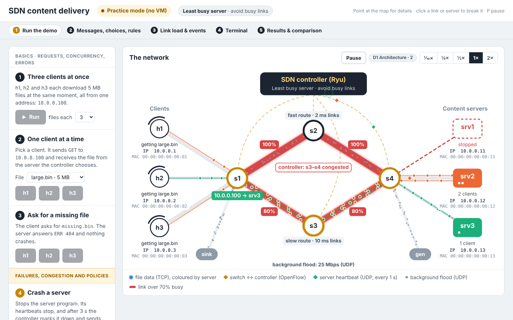

# Demo dashboard

A web page that runs the whole demo. One command starts the controller, the Mininet network and the
three content servers; the page then shows what the controller is doing and lets you trigger every
scenario from the browser.



*Practice mode: srv1 stopped and the flood jamming the fast route, so the controller sends h1–h3 to srv2 and srv3 over the slow route.*

## Start it

From the project folder, with nothing else running (it cleans up old Mininet itself):

```bash
cd ~/sdn-content-delivery
sudo python3 dashboard/demo.py
```

Open **http://localhost:8080** in the VM's browser. Startup takes about 15 seconds (controller,
switches, then the three servers reporting UP).

Everything for D1 and D2 is on this one page. The bar under the title jumps between its five
sections (it only scrolls; there are no other pages). The terminal keeps the usual `mininet>` prompt as a
backup; type `exit` there to stop everything. Everything the page does is printed there as it happens:
each click as the equivalent `mininet>` command, the controller's decisions, server health, link
cuts, congestion (`[MONITOR]`), moved downloads (`[REROUTE]`) and the clients' output. Practice mode
(`--sim`) prints the same kind of lines.

### Open it from your Mac (network still runs in the VM)

```bash
sudo python3 dashboard/demo.py --host 0.0.0.0
```

The terminal prints the address to use, e.g. `http://192.168.64.5:8080`. Open that in Safari or
Chrome on the Mac. Everything you click there acts on the real Mininet network inside the VM. With
UTM's default *Shared Network* the Mac can reach the VM directly; if it can't, check the VM's network
mode in UTM.

| Option | Meaning |
|---|---|
| `--policy static` / `round_robin` / `least_loaded` | Server policy to start with (default `least_loaded`) |
| `--path-policy delay` / `congestion` | Path policy to start with (default `congestion`) |
| `--port 8081` | Use another port if 8080 is busy |
| `--host 0.0.0.0` | Open the page from another computer, e.g. the Mac, at `http://<VM IP>:8080` |
| `--sim` | Simulated network: no sudo, no Mininet (see below) |

Every session's logs and CSVs are saved in `results/demo/<date_time>/`: one log per controller start,
`decisions.csv`, `h1.csv`…`h3.csv`, server logs and flood output.

## Terminal ⇄ dashboard

The VM terminal and the page show the same activity:

- **Page → terminal:** every click is printed at the `mininet>` prompt as the equivalent command
  (`[dashboard] clicked on the web page = mininet> h1 python3 app/client.py ...`), followed by the
  controller's decisions (`[controller] [LB] h1:50408 -> srv1 via s1-s2-s4`), health and link events, and
  the client programs' output (`[client] [h1] #1 large.bin from srv1 ...`).
- **Terminal → page:** downloads typed at `mininet>` show in the page's decisions, rules and results;
  link cuts and server crashes show on the map.

`--quiet-terminal` turns the terminal echo off.

## What's on the page

Each panel carries a small tag naming the rubric item it shows (D1 or D2).

**1 · Run the demo** — the steps (left) and the live map (right, stays in view while you scroll the steps).

| Step | What it does |
|---|---|
| 1 Three clients at once | h1, h2, h3 each download 1–10 × 5 MB from `10.0.0.100` at the same time |
| 2 One client at a time | one client, a file of your choice |
| 3 Ask for a missing file | `GET missing.bin` → `ERR 404`, nothing crashes |
| 4 Crash a server | stop/start srv1, srv2, srv3; after 3 s without heartbeats the controller marks it down |
| 5 Cut a link | cut/restore s1–s2, s2–s4, s1–s3, s3–s4; running downloads move to the other route |
| 6 Jam the fast route | UDP flood from `gen` to `sink` at 15/25/40 Mbps |
| 7 Change the controller's rules | server choice (least loaded / round robin / static) and route choice (congestion / delay); restarts the controller |
| 8 Guided tests | the four automated scenarios, with live progress and Stop |
| Fix everything · Clear results | links up, servers running, flood off · start a fresh comparison |

The map shows file data, OpenFlow messages (PACKET_IN, FLOW_MOD), heartbeats, the address swap at s1,
how busy each link is (red above 70%), cut links, the flood, reroutes and servers being marked down.
Point at anything for details; click a link or a server to cut/restore or stop/start it, or a switch to
see its rules. **Pause** (P), **Step ▸** (→) and **⅒× ¼× ½× 1× 2×** change only the animation.

**2 · Messages, choices, rules**
- *Socket messages*: each `GET` and its `OK`/`ERR` reply, open connections, UDP heartbeats.
- *Controller's choice*: which server and route each download got, the loads it saw, and why
  ("slow route, because s1–s2 is cut").
- *Rules in switch s1–s4*: the real OpenFlow tables in plain words, with the raw `ovs-ofctl` output and
  the s1 rule log pop-up (also saved as `s1_rules.log` / `s1_rules.csv`, *Download CSV*).

**3 · Link load & events** — the fast and slow route's load over the last 2 minutes with the 70% line
and your actions marked, and *What the controller noticed*: servers down/up, links cut/back,
congestion, moved downloads (optionally every server choice).

**4 · Terminal** — a copy of the lines printed in the VM terminal (see above), including commands
typed at `mininet>`.

**5 · Results & comparison** — requests served, average response time and throughput, retries and
failures, errors handled; every request on a chart; a table grouping requests by controller setting
and network condition (best values in green); and the measured experiments with their graphs (click a
graph to enlarge it).

While the dashboard runs, the controller keeps each address-swap rule for **40 s** after its download
(`VIP_IDLE_TIMEOUT=40`) so the rules can be read; hand runs and the experiment runner keep 15 s.

## Suggested demo (about 12 minutes)

1. **Step 1** (×1): three clients, three servers. Show the socket messages, the controller's choice and s1's rules.
2. **Step 3**: the `ERR 404` reply.
3. **Step 5**: start step 1 (×3), then cut s1–s2. The downloads move to s1–s3–s4 (map, s3 rules, events).
4. **Step 6**: start the flood, then step 1. New downloads avoid the busy route.
5. **Step 4**: stop srv1 during step 1 (×3). After 3 s it is marked down and nobody is sent to it.
6. **Step 7**: Clear results, run step 1 under *Always srv1*, then under *Least busy server*. Read the comparison table.
7. **Results**: close with the measured experiments.

Use **Fix everything** between steps. **Pause** and **⅒×** help when explaining the packets.

## Rehearsal without Mininet

```bash
python3 dashboard/demo.py --sim
```

Same page and controls, driven by a simple model of the network. Behaviour matches the real system
(policies, failure detection after 3 s, congestion-aware paths, retries), but the numbers are rough
estimates; a banner says so. Works on any computer with Python 3, including the Mac.

## How it connects to the project

- `demo.py` builds the same topology as `topology/topo.py`, starts `controller/lb_controller.py` the
  same way `tests/run_experiments.py` does, and runs the real `app/server.py` and `app/client.py` in
  the Mininet hosts. Link failures use `net.configLinkStatus`, the flood uses `iperf` from `gen` to
  `sink`, exactly as in the experiments.
- The controller writes a JSON snapshot every second when `LB_STATE_JSON` is set (only `demo.py`
  sets it, so hand runs and the experiment runner are unchanged). It holds server state, per-link
  utilisation and the path each live connection is using.
- The rules panel runs `ovs-ofctl -O OpenFlow13 dump-flows sN` in the VM each time it refreshes, so it
  shows exactly what is in the switch. The animation is driven by the same state: connection paths
  come from the controller, link load from its port statistics, decisions from its decisions CSV.
  Packet dots are a visual rate indicator, not a packet-by-packet capture.
- Changing the policy restarts the controller with new `LB_POLICY` / `PATH_POLICY` values and clears
  the old rules from the switches. Downloads must finish first.
- The web server listens on localhost only by default, because it runs as root and can kill
  processes.

## Troubleshooting

| What you see | Fix |
|---|---|
| `ryu-manager not found` | Pass `--ryu /path/to/ryu-manager` (default is `~/ryu-env/bin/ryu-manager`) |
| `Test files missing` | `python3 app/make_content.py` |
| Port 8080 in use | `--port 8081` |
| "Controller offline" | The controller stopped; check the newest `controller_N.log` in the session folder |
| A server shows "not reporting" but the process is running | Load reports are delayed (e.g. by a flood on its link); it recovers once reports arrive |
| Rules change refused | Wait for downloads to finish, or press Fix everything |
| The Mac can't open the page | Start with `--host 0.0.0.0`, use the address it prints, and check the VM's IP with `ip -4 addr` |
| OpenFlow table shows an error | `ovs-ofctl` must run as root; start `demo.py` with `sudo` |
